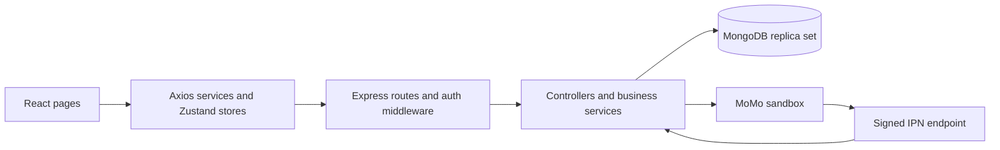

# Portfolio guide

## Architecture

The React application sends requests through Axios service modules. DTO normalizers translate MongoDB documents into frontend types; Zustand stores coordinate authentication, catalog, cart and order state. React Router separates public, authenticated and administrator routes.

Express routes apply authentication/authorization middleware, controllers adapt HTTP input/output, and services own validation and business operations. Mongoose models define persisted records. Category and brand services use repositories; order, cart and product services work directly with models where transaction/session handling is required.

## Engineering decisions to discuss

| Problem | Implementation | Tradeoff |
| --- | --- | --- |
| Client modifies prices | Recalculate prices by SKU on the server | Displayed prices may change before checkout |
| Retried checkout creates duplicates | User-scoped idempotency key plus request hash and unique index | Changed checkout content needs a new key |
| Partial stock updates | Create order and decrement stock in one transaction | MongoDB replica set is required |
| Admin overwrites newer stock | Expected version / optimistic concurrency | Stale edits return 409 and need a reload |
| Callback replay or browser closes | Signed IPN, persisted attempts, reconciliation | Gateway/network access must be operational |
| Unknown payment result | Retain inventory until a terminal result is known | Stuck transactions need operational review |
| Test contamination | Temporary replica set and mocked gateways | Local tests need `mongod` installed |

Payments and order status are separate. COD becomes paid on delivery. MoMo success is recorded from verified IPN or server-side query, not redirect parameters. Late or duplicate settlements require review; automatic refunds are not implemented.

## Five-minute demonstration

1. Use the fictional catalog seeded into `neuralstore_demo`. Register a customer account; use a separate account for admin actions.
2. Filter by category/price, inspect product variants, compare products and ask the shopping assistant for an option within a budget.
3. Add a specific SKU to cart and place a **COD** order. Show that the order appears in customer history and stock changes in admin.
4. Demonstrate cancellation and stock restoration, then place another COD order and advance it through confirmation, shipping and delivery. Show payment status and dashboard revenue.
5. Open the tests to explain duplicate requests, concurrent stock consumption and transaction rollback. Explain the MoMo sandbox flow separately and disclose the hosted 403 limitation.

Do not present fictional products as commercial inventory or claim a completed live payment when only sandbox/mock tests were run. Hosted availability is not guaranteed by the repository.

## Suggested CV wording

**English**

**NEURALSTORE — Full-stack e-commerce application** · React, TypeScript, Express, MongoDB

- Built customer storefront and admin workflows for SKU-based catalog, cart, checkout, order tracking and product reviews with role-based authorization.
- Implemented transactional inventory updates, idempotent checkout and optimistic concurrency to handle retries and conflicting stock changes.
- Integrated MoMo sandbox request signing, IPN verification and reconciliation; added automated frontend/backend checks through GitHub Actions.

**Tiếng Việt**

- Xây dựng website thương mại điện tử với giao diện khách hàng và quản trị, hỗ trợ sản phẩm theo SKU, giỏ hàng, đặt hàng và đánh giá.
- Xử lý tồn kho bằng MongoDB transaction; chống tạo đơn trùng và bảo vệ cập nhật đồng thời bằng idempotency key, optimistic concurrency.
- Tích hợp MoMo sandbox với xác thực IPN và đối soát giao dịch; thiết lập kiểm thử tự động và CI bằng GitHub Actions.

Chỉ bổ sung vai trò, thời gian thực hiện, số thành viên và số liệu hiệu năng khi bạn có dữ liệu thực tế. Không ghi “LLM-powered”, “production-ready payments” hoặc số lượng người dùng/doanh thu chưa được đo.
